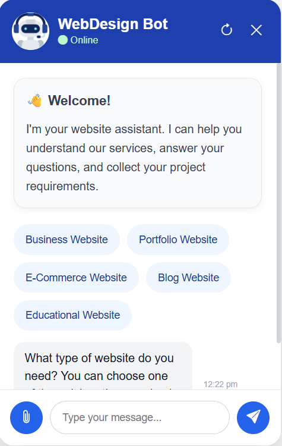

# Website Requirement Chatbot

A modern, responsive chatbot built using **Flask, HTML, CSS, and JavaScript** that collects website requirements from potential clients. The chatbot guides users through a structured conversation, validates user input, supports multiple file uploads, and stores all collected information in JSON format.

This project is designed to be easily integrated into other websites and can also serve as a standalone web application.

---

# Features

- Modern responsive chatbot interface
- Floating chatbot widget
- Guided conversation flow
- Smart website type detection
- Quick website selection buttons
- Support for 50+ website categories
- Natural website type recognition (e.g. "Restaurant" → "Restaurant Website")
- Multiple file upload support
- Attachment preview and removal
- Input validation
- Typing animation
- Automatic scrolling
- Chat reset functionality
- User data storage in JSON
- Integration-ready Flask backend

---

# Technologies Used

## Frontend

- HTML5
- CSS3
- JavaScript
- Bootstrap Icons

## Backend

- Python
- Flask

## Storage

- JSON

---

# Project Structure

```text
chatbot_project/
│
├── static/
│   ├── css/
│   │   └── chatbot.css
│   ├── js/
│   │   └── chatbot.js
│   └── images/
│
├── templates/
│   └── index.html
│
├── uploads/
│
├── chatbot_manager.py
├── responses.json
├── user_data.json
├── server.py
├── requirements.txt
└── README.md
```

---

# Installation

## 1. Clone or download the project

Extract the ZIP file.

---

## 2. Install dependencies

```bash
pip install -r requirements.txt
```

---

## 3. Run the Flask server

```bash
python server.py
```

---

## 4. Open the application

```
http://127.0.0.1:5000
```

---

# Chatbot Workflow

1. User opens the chatbot.
2. Selects a quick option or types a website type.
3. Enters business name.
4. Describes project requirements.
5. Enters estimated budget.
6. Provides name.
7. Provides email address.
8. Provides phone number.
9. Uploads supporting files (optional).
10. Chatbot stores all collected information.

---

# Website Types Supported

Examples include:

- Business Website
- E-commerce Website
- Portfolio Website
- Blog Website
- Restaurant Website
- Cafe Website
- Hotel Website
- School Website
- College Website
- Hospital Website
- Clinic Website
- Gym Website
- Travel Website
- Real Estate Website
- Startup Website
- Agency Website
- NGO Website
- Photography Website
- Event Website
- Marketplace
- Booking Website

The chatbot also recognizes simple user inputs such as:

- Restaurant
- Hotel
- Hospital
- Gym
- School
- Portfolio
- Startup
- Agency
- Business

and automatically maps them to the correct website type.

---

# Data Storage

The chatbot stores:

- Website type
- Business name
- Project requirements
- Budget
- Customer name
- Email
- Phone number
- Uploaded file information

Collected information is stored in:

```
user_data.json
```

Uploaded files are stored in:

```
uploads/
```

---

# API Endpoints

The Flask backend exposes the following endpoints:

| Endpoint | Method | Description |
|----------|--------|-------------|
| `/chat` | POST | Process chatbot messages |
| `/upload` | POST | Upload attachment files |
| `/reset` | POST | Reset chatbot conversation |
| `/` | GET | Load chatbot interface |

---

# Integration Guide

This chatbot can be integrated into another website.

## Option 1 – Standalone (Current Project)

Run the Flask application.

```bash
python server.py
```

Open:

```
http://127.0.0.1:5000
```

The chatbot works as a complete standalone website.

---

## Option 2 – Integrate into an Existing Website

To integrate the chatbot into another website:

### Copy the frontend files

```
static/css/chatbot.css

static/js/chatbot.js
```

Copy the chatbot HTML from:

```
templates/index.html
```

into the target website.

### Keep the Flask backend running

The chatbot communicates with these endpoints:

```
POST /chat
POST /upload
POST /reset
```

If hosted on another server, update the fetch URLs in `chatbot.js` to point to the backend server.

Example:

```javascript
fetch("https://your-domain.com/chat")
```

instead of

```javascript
fetch("/chat")
```

The chatbot frontend and backend can therefore be hosted separately.

---

# Future Improvements

Possible future enhancements include:

- MySQL or PostgreSQL integration
- Admin dashboard
- Email notifications
- AI-powered chatbot responses
- Live chat support
- Drag-and-drop uploads
- User authentication
- One-line embeddable widget using a single `<script>` tag

---

# Screenshots



---

# License

This project was developed as part of an internship project and is intended for educational and demonstration purposes.